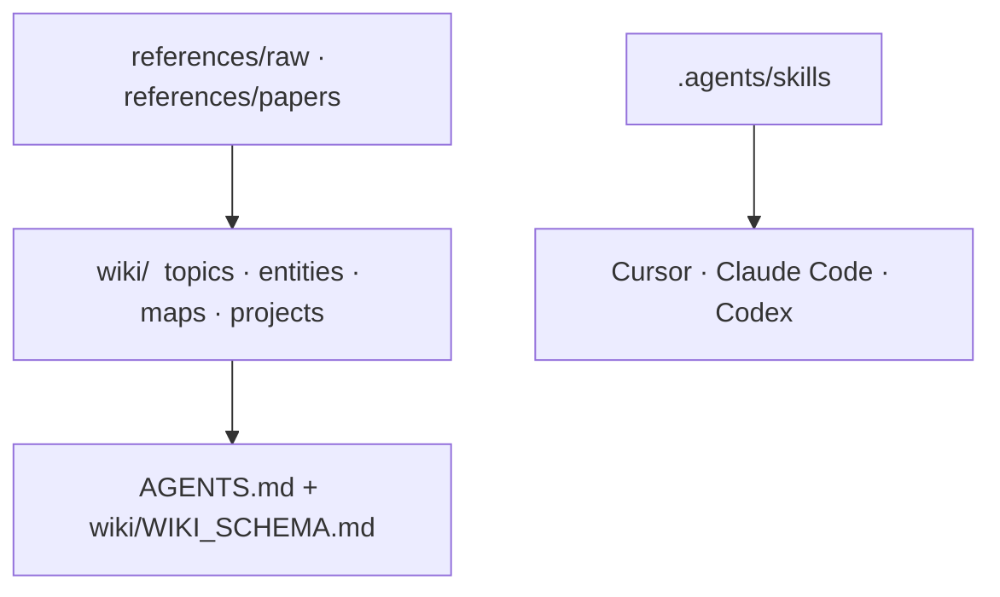

# wiki

**Git + Markdown + Agent 维护的个人复利知识库。** 原件进 Raw，可复用结论进 Wiki；人和 Agent 共用同一套目录。

*A personal compounding wiki in git and Markdown, maintained with an agent. Inspired by Karpathy's LLM Wiki.*

[](https://www.python.org/downloads/)

**先看**：[wiki教学与使用手册](wiki/maps/wiki-teaching-usage-handbook.md) · [主题索引](wiki/index.md) · [目录契约](wiki/WIKI_SCHEMA.md)

## 为什么有这个仓库

[Karpathy LLM Wiki](https://gist.github.com/karpathy/442a6bf555914893e9891c11519de94f) 的做法是：原始材料与提炼后的 wiki 分开，让模型在 Markdown 上持续编译知识。这里把它收成一个可审计的 git 仓库。

- 写入和检索以仓库里的 Markdown 为准。Obsidian 只作可选浏览器。
- 结论写进 `wiki/`，原件留在 `references/raw/`。
- 约定写在 [`AGENTS.md`](AGENTS.md) 和 [`wiki/WIKI_SCHEMA.md`](wiki/WIKI_SCHEMA.md)。技能正文在 `.agents/skills/`，Cursor、Claude Code、Codex 使用同步后的镜像。

## 功能

- **机器 lint**：frontmatter、相对链接、orphan 候选；`growing` / `stale` 缺 `review_after` 时 warning
- **`/query` + 金标**：先读 index，再读 map / topic；答案引用仓库路径。格式检查在 `wiki/evals/`，不建向量库
- **矛盾与取代**：冲突页禁止静默覆盖；`supersedes` / `superseded_by` 可选，lint 只警告「已被取代的页仍被 index 主推」
- **操作日志 + 可选 L2**：`wiki/log.md` 记 ingest / query / lint。默认 L1；说出「L2 / 深挖 / compile / 级联」才级联相关页
- **source-clock**：`wiki/` 外的 source 文件若 mtime 日期晚于页的 `updated`，lint warning，不改写 `status`
- **行为记忆**：`wiki/projects/learning-progress/` 放偏好、纠错和教学进度。事实仍在 topics / entities。不要求 Mem0
- **技能同步**：正文只在 `.agents/skills/`。`check_skill_sync.py` 用 SHA-256 对照三份宿主镜像

## 结构



| 层 | 路径 | 谁来写 |
|----|------|--------|
| Raw | `references/raw/`、`references/papers/` | 原件。Agent 默认不改写正文 |
| Wiki | `wiki/` | 人类和 Agent 一起维护的笔记与导航 |
| Schema | `AGENTS.md`、`wiki/WIKI_SCHEMA.md` | 目录约定与机器规则 |
| Skills | `.agents/skills/` | 技能正文。`.cursor/`、`.claude/`、`.codex/` 只做镜像 |

## 快速开始

依赖：Python 3.11+、[PyYAML](https://pypi.org/project/PyYAML/)。测试另需 pytest。

```bash
git clone https://github.com/masterroland13/wiki.git
cd wiki
python3 scripts/lint_wiki.py
```

对 Agent 直接说：

| 想做的事 | 怎么说 |
|----------|--------|
| 把 URL、截图或聊天归档进来 | `投喂 wiki` 或 `/wiki` |
| 按已有笔记回答 | `/query` 或「根据笔记回答」 |
| 整理 inbox、到期页 | `/review` |
| 查坏链和 frontmatter | `lint 一下 wiki` |
| 推导、复习、系统学 | `/teacher`；算法 / 面试用 `/teacher-cs` |

找不到能支撑回答的页时，Agent 应写明 **I can't find**，不编造路径。

## 技能

正文在 `.agents/skills/`。触发词在各 `SKILL.md` 的 description 里。

| 技能 | 用途 |
|------|------|
| `/wiki` | URL、截图、聊天 → Raw + Wiki。默认 L1 |
| `/query` | 用已有页回答，并引用仓库路径 |
| `/lint` | 先跑 `scripts/lint_wiki.py`，再看导航 |
| `/review` | inbox、到期页、互链。启动时先读行为记忆 |
| `/teacher` | 教练式学习（通用 + CS） |
| `/teacher-cs` | CS 别名：算法、LeetCode、面试 |

## 脚本

| 命令 | 作用 |
|------|------|
| `python3 scripts/lint_wiki.py` | 机器 lint。`0` 无 error（可有 warning）；`1` 有 error，或 `--strict` 下有 warning |
| `python3 scripts/check_retrieval_cases.py` | `/query` 金标的格式和期望路径是否存在 |
| `python3 scripts/check_skill_sync.py` | 技能镜像与 `.agents/skills/` 逐文件哈希。漂移为 `1` |
| `scripts/wiki_verify_images.sh <md>` | 检查文中图片相对路径。`0` 全部存在 |
| `python3 -m pytest scripts/ -q` | 上述脚本的单元测试 |

`scripts/ingest_url_to_raw.py` 在手册里是约定入口。仓库尚未提供该文件时，由 Agent 抓取 URL 再写入 Raw。

## 目录

```
.
├── AGENTS.md              # 项目正文、技能、文档索引
├── CLAUDE.md              # Claude Code 的索引镜像
├── README.md
├── ROADMAP.md             # 工程 backlog
├── docs/                  # 调研、施工计划、切片审查
├── references/
│   ├── raw/               # 原件收件箱
│   └── papers/            # PDF（可选）
├── scripts/
├── wiki/
│   ├── index.md           # 主题入口
│   ├── WIKI_SCHEMA.md
│   ├── changelog.md       # 结构性变更
│   ├── log.md             # ingest / query / lint
│   ├── inbox.md
│   ├── maps/ topics/ entities/ papers/ projects/ templates/
│   ├── evals/             # /query 金标
│   └── references/
└── .agents/skills/        # 技能正文
```

## 手册与工程文档

上手、工作流、模板和归档深度：[**wiki教学与使用手册**](wiki/maps/wiki-teaching-usage-handbook.md)。  
旧路径 [`wiki/maps/wiki-user-guide.md`](wiki/maps/wiki-user-guide.md) 只做跳转。

| 文档 | 内容 |
|------|------|
| [`docs/README.md`](docs/README.md) | 工程文档索引 |
| [`docs/research/llm-wiki-frontier-2026-11.md`](docs/research/llm-wiki-frontier-2026-11.md) | 2026-11-02 前沿调研：抄什么、不抄什么 |
| [`docs/plans/wiki-frontier-upgrade.md`](docs/plans/wiki-frontier-upgrade.md) | Slice A–J 施工计划 |
| [`docs/handbooks/wiki-slice-audit.md`](docs/handbooks/wiki-slice-audit.md) | 每一刀结束后的审查清单 |

## 切片状态

| 切片 | 状态 | 一句话 |
|------|------|--------|
| A | 已完成 | `scripts/lint_wiki.py`：frontmatter、链接、orphan |
| B | 已完成 | `/query` + `wiki/evals/retrieval-cases.md` |
| C | 已完成 | 矛盾与取代协议；不自动裁定对错 |
| D | 已完成 | `wiki/log.md`；L2 compile 须明示，默认仍 L1 |
| E | 已完成 | source-clock stale warning，不写回页面 |
| F | 已完成 | 行为记忆层与写入路由 |
| G | 未做 | Hybrid 检索。实质页 ≥50，或 index 命中率低于约定阈值之后再评估 |
| H | 未做 | Entity / map 强化与 index 空壳清理 |
| I | 已完成 | `.agents/skills/` 为正文；镜像哈希校验 |
| J | 未做 | 轻量只读浏览。需要时再做；不作为写入来源 |

## 参与维护

1. 知识页按 [`wiki/WIKI_SCHEMA.md`](wiki/WIKI_SCHEMA.md) 写。两条主张对不上时，写成 `## Contradictions` 或 supersession 字段，保留旧页。
2. 技能只改 `.agents/skills/`，再把同一内容复制到 `.cursor/skills/`、`.claude/skills/`、`.codex/skills/`。
3. 提交前跑：

```bash
python3 scripts/check_skill_sync.py
python3 scripts/lint_wiki.py
python3 -m pytest scripts/ -q
```

结构性变更记在 [`wiki/changelog.md`](wiki/changelog.md)。一次 ingest / query / lint 记在 [`wiki/log.md`](wiki/log.md)。工程上还没做的事写在 [`ROADMAP.md`](ROADMAP.md) 的 Icebox。
